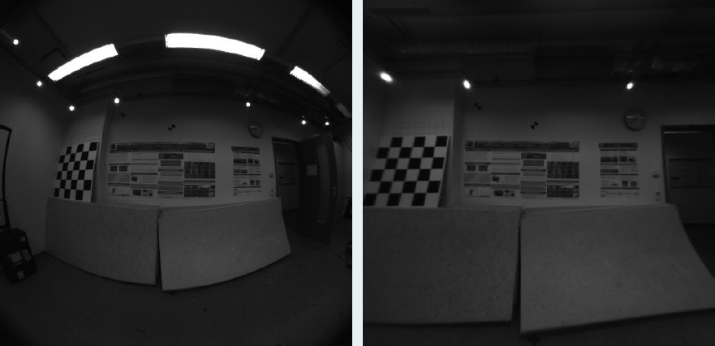
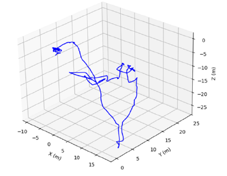

# 🛰️ Visual-Inertial Odometry (VIO)

<p align="center">
  
</p>

This project implements a **Visual-Inertial Odometry (VIO)** pipeline using stereo camera images and IMU data.  
The goal is to estimate the 3D trajectory of a moving platform by fusing **visual** and **inertial** information.

---

## ⚙️ Requirements

### 🧩 Python Libraries
Install all dependencies with:

```bash
pip install numpy pandas opencv-python scipy matplotlib tqdm
```

### 📦 Dataset
Download the dataset from the TUM-VI dataset:

🔗 [TUM-VI corridor4_512_16.tar](https://vision.in.tum.de/tumvi/exported/euroc/512_16/dataset-corridor4_512_16.tar)

Extract and place the folder  
`dataset-corridor4_512_16/`  
in the **same directory** as the project scripts.

---

## 🔍 Pipeline Overview

1. 🪞 **Image Undistortion and Rectification**  
2. 🎯 **Feature Detection and Description**  
3. 🔗 **Feature Matching (Stereo & Temporal)**  
4. ☁️ **3D Point Cloud Generation**  
5. 🚗 **Visual Odometry (VO) Estimation**  
6. 🧭 **Sensor Fusion using Extended Kalman Filter (EKF)**

---

## ▶️ Execution Order

Run the scripts in the following order:

### 1️⃣ `step1_undistortion.py`
- Undistorts and rectifies stereo images  
- **Outputs:**
  - `cam0_images_undistorted/`, `cam1_images_undistorted/`
  - `rectified/`
  - `calibration_data_rectified/`

---

### 2️⃣ `step2_feature_detection_and_description.py`
- Detects features in rectified images  
- **Outputs:**
  - `features/keypoints/`
  - `features/descriptors/`

---

### 3️⃣ `step3_feature_matching_between_cams_and_frames.py`
- Performs stereo and temporal feature matching  
- **Outputs:**
  - `features/stereo_matches_filtered/`
  - `features/temporal_matches_filtered/`

---

### 4️⃣ `step4_pointcloud.py`
- Generates 3D point clouds from stereo matches  
- **Outputs:**
  - `features/pointclouds/`

---

### 5️⃣ `step5_TVO.py`
- Computes relative motion between frames (Visual Odometry)  
- **Outputs:**
  - `features/relative_motions_vo/`
  - `features/vo_covariance/`

---

### 6️⃣ `downsample_inertial.py`
- Downsamples IMU data to match the camera frame rate  
- **Outputs:**
  - `features/processed/inertial_vectors.npy`

---

### 7️⃣ `ekf.py`
- Fuses **visual** and **inertial** data using an **Extended Kalman Filter**  
- **Outputs:**
  - `features/processed/ekf_trajectory.npy`
  - Displays a 3D trajectory plot

---

## ⏱️ Expected Runtime
The complete pipeline may take several minutes to run —  
most computation time is spent on **image processing** and **feature matching** stages.

---
<p align="center">
  
</p>

## 🧠 Notes
- Make sure the dataset paths and file names match exactly.
- Intermediate folders will be created automatically if missing.
- The EKF output (`ekf_trajectory.npy`) can be visualized in 3D with Matplotlib.

---
